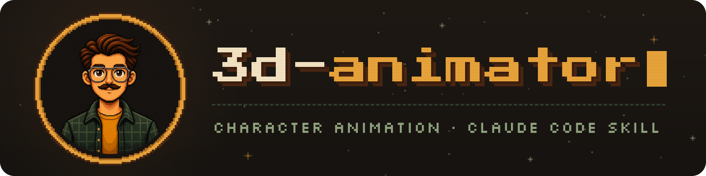
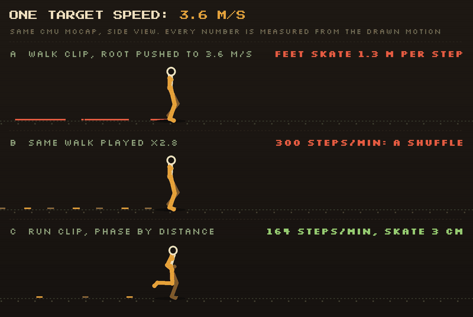
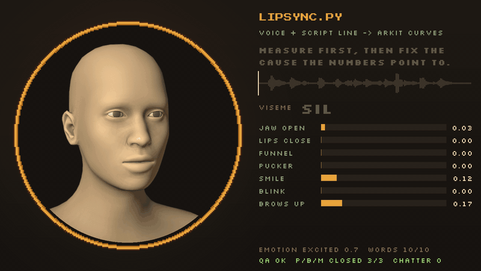
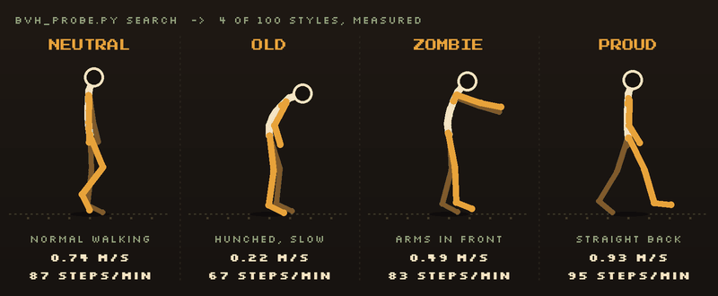

<div align="center">



**Анимация персонажей в Claude Code: тело и лицо** — от автора YouTube-канала [@studioigor](https://www.youtube.com/@studioigor).

Заригать скан или сгенерированного персонажа, найти открытый мокап, поставить ноги на землю, заставить лицо говорить под озвучку — и доказать каждую правку цифрами.

[English](README.md) · **Русский**


[](https://www.youtube.com/@studioigor)


</div>

## Установка одним промптом

Отправьте этот промпт вашему агенту (рекомендуется Claude Code, но работает и с другими):

```text
Установи скилл 3d-animator https://github.com/studioigor/3d-animator-skill
```

Дальше отправьте агенту: `/3d-animator` и опишите персонажа и что он должен делать. Слово «анимация» можно даже
не говорить: хватит *«ноги скользят»* или *«рот не попадает в голос»*.

---

**3d-animator** ведёт персонажа от меша до утверждённого движения: риг, клипы, локомоция, процедурные слои, лицо,
липсинк, интеграция в движок и ревью. На каждом шаге один и тот же цикл:

1. **Измерить** проблему скриптом или пробой.
2. **Исправить** причину, на которую указывают цифры.
3. **Показать** до/после в одни и те же моменты времени, с цифрами рядом.

**Результат оцениваете вы. Причину находят цифры.**

## Сначала измерь



Одна целевая скорость, три способа её получить, настоящий мокап CMU:

- **A.** Тянуть клип ходьбы быстрее, чем он идёт: ноги проскальзывают **на 1,3 м за шаг**.
- **B.** Проиграть ходьбу в 2,8 раза быстрее: ноги стоят, но выходит семенящая походка, **300 шагов в минуту**.
- **C.** Взять клип с подходящей собственной скоростью и вести его фазу по пройденному пути: **3 см** проскальзывания.

`bvh_probe.py` измеряет скорость, каденс, контакты и нужную для целевой скорости скорость проигрывания у любого
клипа — до того, как вы его выберете.

## Липсинк по реплике



`lipsync.py` превращает озвучку и строку сценария в ARKit-кривые блендшейпов на 60 fps плюс глаза, голову и слой
эмоции, а потом проверяет себя: каждая п/б/м смыкает губы, челюсть не дребезжит, диапазоны в норме.
`apply_face_curves.py` накатывает кривые на риг в Blender: ARKit, CC/Reallusion, VRM или ваша карта имён.
Здесь голова MakeHuman (CC0) произносит девиз скилла. Для русского есть встроенные правила произношения;
английский и другие языки идут через espeak-ng, а без него английский читается по упрощённым правилам.

## Библиотека, которую можно искать и мерить



`fetch_library.py` скачивает открытые данные движения с проверкой лицензий: CMU (~2500 клипов), 100STYLE
(100 стилей локомоции), риги и клипы Mesh2Motion, модель лица MediaPipe. `bvh_probe.py search` ищет клипы по
словам, `stats` их измеряет, `sheet` рисует контактные листы из палочных фигурок.

## Как это выглядит

```text
Вы        Этот сканированный солдат должен дойти до двери, взяться за ручку и сказать одну реплику.
Аниматор  Два вопроса: какой движок и должно ли лицо остаться один в один как у скана?
Аниматор  Риг: скелет из библиотеки клипов вписан в меш, поэтому клипы переносятся точно.
          Стресс-позы: наплечники рвутся выше 75°, взмах руки ограничен этим углом. Лист приложен.
Аниматор  Ходьба 1,4 м/с: CMU 35_01 идёт 1,27 м/с, значит проигрывается в 1,1 раза быстрее. Контакты чистые.
Вы        На остановке ноги скользят.
Аниматор  Измерил остановку: корень продолжает ехать, когда обе ноги уже стоят. Теперь фаза идёт по
          пройденному пути. Видео до/после с цифрами приложено.
Аниматор  Лицо: липсинк по вашей озвучке, все смыкания п/б/м проходят. Ревью-ролик с субтитрами приложен.
```

## Что внутри

| Раздел знаний | О чём |
|---|---|
| Подготовка | инструменты, библиотека анимаций и лицензии, Mixamo и платные источники, правила headless-Blender |
| Риггинг | сканы, сгенерированные и шаблонные тела: подготовка меша, посадка скелета, скиннинг объёмных костюмов, кисти, экспорт |
| Клипы и ретаргет | выбор и замеры клипов, text-to-motion и видео-референсы, точный ретаргет, запекание |
| Локомоция | походки без скольжения ног, скорости по пути, группы, четвероногие и существа, неровная земля, всадники |
| Игра движения | вес, удар, тайминг и телеграфы атак, попадания и смерти, гиганты, мизансцена |
| Процедурная анимация | IK, взгляд, контакты рук между персонажами, предметы и оружие, пружины, руки от первого лица |
| Лицевой риг | живое лицо на сканированной голове: ориентиры, топология точно по скану, перенос ARKit-выражений |
| Лицевая анимация | формат face-curves, липсинк, эмоции, моргания и взгляд, захват лица с видео |
| Unity | импорт и аватары, ловушки Mecanim, риги под Timeline, офлайн-рендеры из edit mode |
| Проверка | анимационная лаборатория, числовые пробы, проверка контактов, разбор жалоб, ревью-видео |

| Скрипт | Что делает |
|---|---|
| `check_tools.py` | проверяет Blender, MPFB, ffmpeg, Python-пакеты, библиотеку и диск; для каждого пробела пишет исправление |
| `fetch_library.py` | скачивает открытый мокап, риги и модели с проверкой лицензий, с докачкой |
| `bvh_probe.py` | ищет в библиотеке, измеряет клипы (скорость, каденс, контакты), извлекает их, рисует контактные листы |
| `lipsync.py` | озвучка + строка сценария → ARKit-кривые 60 fps с эмоцией, морганиями и QA |
| `face_capture.py` | видео актёра → тот же формат кривых через MediaPipe |
| `apply_face_curves.py` | ключит кривые лица на шейп-кеи и кости головы и глаз в Blender, headless |
| `identity_check.py` | похожа ли нейтраль рига на оригинал? SSIM и ошибка ориентиров в мм |
| `mesh_gate.py` | сложенные, наклонённые и вырожденные треугольники на каждом шейп-кее и на сочетаниях |
| `subdiv_keys.py` | подразделение Catmull-Clark, которое точно переносит все шейп-кеи |
| `contact_sheet.py` | покадровые контактные листы и ревью-видео бок о бок |

## Принципы

- 📏 **Сначала измерь.** Покадровые трассы и пробы находят причину, глаза — только симптом.
- 🦶 **Скорость не чинят скоростью проигрывания.** Берите клип, близкий к нужной скорости, и ведите фазу по пути.
- 🎯 **Точное лучше хитрого.** Риг на собственном скелете библиотеки ретаргетится с ошибкой 0,00°.
- ⏱️ **Поза — функция времени,** поэтому её можно скрабить, рендерить офлайн, и она совпадает с play mode.
- 🧥 **Что возможно, решает меш.** Объёмные костюмы и цельные перчатки становятся ограничениями, а не борьбой.
- 🙂 **Сходство измеряется.** Лицо проходит автоматическую проверку на сходство и чистую деформацию до того, как
  вы его увидите.
- 💸 **Вкус и деньги — ваши.** Варианты приходят как медиа до/после, кредиты не тратятся без спроса, ничего не
  подменяется молча.

## Открытые данные и уважение к лицензиям

| Источник | Лицензия | Как с ним работает скилл |
|---|---|---|
| Mesh2Motion | арт CC0, код MIT | первая небольшая загрузка; для клипов из CMU сохраняется кредит CMU |
| Мокап CMU | бесплатно, в том числе коммерчески; нельзя перепродавать как датасет | строка кредита хранится в `LIBRARY.md` |
| 100STYLE | CC BY 4.0 | строка кредита хранится в `LIBRARY.md` |
| LAFAN1, Bandai Namco | некоммерческие | только с `--accept-noncommercial`; LAFAN1 — только как референс |
| Mixamo | условия Adobe | входите вы сами, клипы по одному, пароль агент никогда не вводит |

Библиотека живёт вне скилла (`~/AnimationLibrary` или `$ANIM_LIBRARY`).

## Попробуйте сказать

- *«Заригай этого сгенерированного персонажа и пусть дойдёт до двери»*
- *«Когда она бежит, ноги скользят»*
- *«Вот озвучка, пусть он это скажет»*
- *«Когда он поднимает руки, они выкручиваются»*
- *«Найди в бесплатном мокапе крадущуюся походку»*
- *«Сними моё лицо с этого видео и перенеси на персонажа»*

## Что нужно

Claude Code, Python 3.9+, Blender 4.2+ (можно headless), ffmpeg. По задаче: MPFB для шаблонных голов,
whisper или mlx-whisper для тайминга слов, espeak-ng для других языков, mediapipe для захвата лица с видео.
`check_tools.py` скажет, чего не хватает и как это поставить. Заметки по движку написаны для Unity; часть про
Blender и данные подходит для любого движка.

## Источники демо-графики

- Движение: [CMU Graphics Lab Motion Capture Database](http://mocap.cs.cmu.edu) (создана при поддержке NSF
  EIA-0196217) и [100STYLE](https://zenodo.org/records/8127870) — I. Mason, S. Starke, T. Komura, CC BY 4.0.
- Голова: базовый меш и expression units MakeHuman через [MPFB](https://static.makehumancommunity.org/mpfb.html), CC0.
- Реплика для демо липсинка синтезирована text-to-speech; аудио в скилл не входит.
- Шрифты в графике: Press Start 2P и Silkscreen, SIL Open Font License.

## Лицензия

MIT — см. [LICENSE](LICENSE).

## Ссылки

- 📺 YouTube-канал: [@studioigor](https://www.youtube.com/@studioigor)
- 💬 Discord-сервер канала: [discord.gg/Jb7dBHSDG](https://discord.gg/Jb7dBHSDG)
- 📲 Телеграм-канал: [t.me/studioigor](https://t.me/studioigor)
- ❤️ Поддержать канал на Boosty: [boosty.to/studioigor](https://boosty.to/studioigor)
- ⚡️ Задонатить: [boosty.to/studioigor/donate](https://boosty.to/studioigor/donate)
